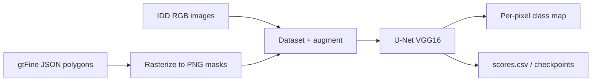

# Traffic Segmentation

Semantic segmentation of driving scenes: assign a class label to every pixel in a road/traffic image (road, vehicles, pedestrians, sky, and related categories). The project trains a **U-Net** with a **VGG16** encoder on the **[Indian Driving Dataset (IDD)](https://idd.insaan.iiit.ac.in/)** segmentation split, using TensorFlow/Keras.

The main deliverable is an end-to-end Jupyter workflow in `tf_seg.ipynb`, from polygon annotations to training, evaluation, and qualitative predictions. Training metrics for a short run are saved in `scores.csv`.

---

## What this project does

1. **Loads IDD-style data** — RGB images from `leftImg8bit` and polygon annotations from `gtFine` (JSON).
2. **Builds pixel masks** — Renders polygons into single-channel PNG masks using a fixed map from 38 semantic class names to IDD label IDs (e.g. `road` → 10, `car` → 80).
3. **Prepares training batches** — Resizes to 256×256, one-hot–style multi-channel targets from unique label IDs, optional `imgaug` augmentations on the training set.
4. **Trains a segmenter** — U-Net with VGG16 backbone (ImageNet weights), **Dice loss**, **IoU** metric, Adam optimizer.
5. **Evaluates visually** — Side-by-side plots of input image, ground-truth mask, and argmax prediction on validation samples.

This is suited to autonomous driving perception, dataset exploration, or as a coursework-style deep learning segmentation baseline.

---

## Repository contents

| File | Description |
|------|-------------|
| `tf_seg.ipynb` | Full pipeline: data indexing, mask generation, model definition, training setup, inference, and results. |
| `scores.csv` | Per-epoch training log: `iou_score`, `loss`, `val_iou_score`, `val_loss`. |

Model weights and preprocessed metadata (`.pkl` mask index files) are **not** included in this repo; the notebook expects them on disk after you run the mask-generation steps or place checkpoints locally.

---

## Dataset layout (IDD Segmentation)

Download and unpack IDD segmentation data, then point the notebook at these folders (train and validation):

```
IDD_Segmentation/
├── leftImg8bit/
│   ├── train/   # RGB driving images
│   └── val/
└── gtFine/
    ├── train/   # *_gtFine_polygons.json per image
    └── val/
```

After running mask generation in the notebook, masks are written under:

```
IDD_Segmentation/Masks/
├── train/
└── val/
```

Metadata dataframes (`train_meta.pkl`, `val_meta.pkl`) cache image paths and corresponding mask paths for faster reloads.

---

## Model and training details

### Architecture

- **Primary model:** [`segmentation_models`](https://github.com/qubvel/segmentation_models) `Unet('vgg16', encoder_weights='imagenet', ...)`.
- **Alternative (in notebook):** Custom `unet_vgg16()` built from `tf.keras.applications.VGG16` with skip connections and a 1×1 softmax head.
- **Input:** `(256, 256, 3)`.
- **Output:** Softmax over **19 classes** (unique IDD label IDs used in the mask encoding, not all 38 raw semantic names).

### Loss, optimizer, and metrics

| Setting | Value |
|---------|--------|
| Optimizer | Adam, learning rate `0.001` |
| Loss | Dice loss (`sm.losses.dice_loss`) |
| Metric | IoU score (`sm.metrics.IOUScore`, threshold 0.5) |

### Data loading

- Custom `Dataset` class: read image/mask paths, resize with OpenCV, build stacked binary channels per class ID.
- Custom `Dataloder` (`tf.keras.utils.Sequence`): batch size **4**, shuffle on train.
- **Augmentation (train only, random):** horizontal flip, vertical flip, emboss, directed edge detect, sharpen (`imgaug`).

### Callbacks (when training)

- `ModelCheckpoint` — save best model by validation loss.
- `CSVLogger` — append metrics to `scores.csv`.
- `ReduceLROnPlateau` — on `val_loss`, factor 0.1, patience 5.
- `EarlyStopping` — on `val_loss`, patience 10.
- Optional TensorBoard logging.

---

## Semantic classes (annotation → mask ID)

The notebook maps **38** polygon labels to IDD-style IDs. Examples:

| Label | ID | Label | ID |
|-------|-----|-------|-----|
| road | 10 | car | 80 |
| sidewalk | 30 | person | 50 |
| building | 140 | vegetation | 150 |
| sky | 160 | traffic sign | 120 |

The full mapping lives in the `label_clr` dictionary inside `tf_seg.ipynb`. Masks store the **grayscale ID** per pixel; training uses the set of **unique IDs** present in that map as class channels.

---

## Sample training results

From `scores.csv` (4 epochs logged in this repo):

| Epoch | Train IoU | Train loss | Val IoU | Val loss |
|-------|-----------|------------|---------|----------|
| 0 | 0.295 | 0.748 | 0.330 | 0.703 |
| 1 | 0.344 | 0.663 | 0.299 | 0.673 |
| 2 | 0.334 | 0.582 | 0.329 | 0.589 |
| 3 | 0.353 | 0.558 | 0.340 | 0.576 |

These numbers are a snapshot from a particular run; full convergence typically requires more epochs and tuned paths/hardware.

---

## Requirements

Install dependencies in a Python 3 environment with GPU support recommended:

```bash
pip install tensorflow segmentation-models opencv-python pillow pandas tqdm matplotlib imgaug joblib scikit-learn jupyter
```

Versions were not pinned in the repo; use TensorFlow 2.x compatible with your CUDA setup if training on GPU. The notebook sets:

- `SM_FRAMEWORK=tf.keras`
- `TF_FORCE_GPU_ALLOW_GROWTH=true`
- `sm.set_framework('tf.keras')`

---

## How to run

1. **Clone the repository**

   ```bash
   git clone https://github.com/Am3nek/Traffic-Segmentation.git
   cd Traffic-Segmentation
   ```

2. **Prepare IDD data** — Download IDD segmentation and arrange `leftImg8bit` and `gtFine` as above.

3. **Update paths in `tf_seg.ipynb`** — The notebook currently uses machine-specific absolute paths for dataset roots, TensorBoard logs, checkpoints, and `.pkl` files. Replace them with your local directories before running.

4. **Generate masks (first time)** — Uncomment and run:
   - `compute_masks(train_df)` / `compute_masks_val(val_df)`
   - `joblib.dump(...)` for `train_meta.pkl` and `val_meta.pkl`  
   On later runs, load the `.pkl` files instead of regenerating masks.

5. **Train** — Uncomment `model.fit(...)` cells with your chosen epoch count and `callbacks`.

6. **Inference** — Load saved weights (`.keras` / `.h5`), run the validation loop that plots original / GT / prediction.

---

## Pipeline overview



---

## Notes and limitations

- **Paths:** Checkpoints, TensorBoard, and dataset paths in the notebook are author-specific; they must be updated for your machine.
- **Large notebook:** `tf_seg.ipynb` may contain heavy cell outputs; clear outputs before committing if file size matters.
- **Class count:** Polygon labels (38 names) differ from model output channels (19 unique ID values); understand this mapping when interpreting metrics and visualizations.
- **No packaged API:** Everything is notebook-driven; there is no separate CLI or inference service in this repo.

---

## License and attribution

- **IDD:** Use of the Indian Driving Dataset is subject to [IDD terms](https://idd.insaan.iiit.ac.in/).
- **Backbone:** VGG16 ImageNet weights via Keras Applications / `segmentation_models`.
- **Remote:** `origin` points to [Am3nek/Traffic-Segmentation](https://github.com/Am3nek/Traffic-Segmentation).

---

## Contributing

Issues and pull requests are welcome. When changing training defaults or paths, prefer configurable variables at the top of the notebook so others can run the pipeline without editing many cells.
